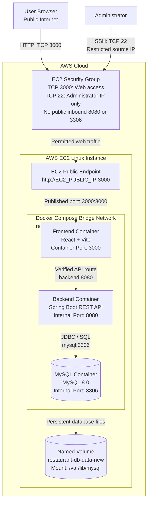

# RestaurantIQ — Docker Deployment Guide

Containerize and deploy the RestaurantIQ three-tier application using Docker, Docker Compose, persistent MySQL storage and AWS EC2.

## System Architecture



| Service | Technology | Port | Exposure |
|---|---|---:|---|
| Frontend | React 18, Vite | `3000` | Public demo entry point |
| Backend | Java 21, Spring Boot | `8080` | Internal only |
| Database | MySQL 8.0 | `3306` | Internal only; no host port mapping |

Use Docker Compose service names instead of fixed container IP addresses. Publish only the ports required for external access. Keep backend and database communication on the Compose network.

## Prerequisites

Install the following tools and prepare the required access:

- Linux host or AWS EC2 Linux instance.
- Git, Docker Engine, and the Docker Compose plugin.
- AWS permissions to manage the EC2 instance and its security group.
- Access to the RestaurantIQ repository or its configured fork.

Verify the installed versions:

```bash
git --version
docker --version
docker compose version
```

Navigate to the repository root, where `docker-compose.yml` resides. Confirm that the service definitions and Dockerfiles match the commands in this guide before starting deployment.

## Configure and Start the Application

### 1. Configure Environment Variables

Create the local environment file and restrict its permissions:

```bash
cp .env.example .env
chmod 600 .env
```

Set the required values for the current Compose configuration:

- `DB_NAME`
- `DB_USER`
- `MYSQL_ROOT_PASSWORD`
- `MYSQL_PASSWORD`

Keep actual credentials in `.env` and exclude the file from Git. Commit only safe placeholder values in `.env.example`.

**Verify the database environment-variable mapping.** The official MySQL image uses variables such as `MYSQL_DATABASE`, `MYSQL_USER`, `MYSQL_PASSWORD`, and `MYSQL_ROOT_PASSWORD` for initial database setup. Map application-specific names such as `DB_NAME` and `DB_USER` to the corresponding MySQL variables in Compose. Configure the Spring Boot datasource to use the correct database hostname, database name, username, and password.

Never commit production credentials or display real secrets in terminal screenshots, logs, or deployment documentation.

### 2. Verify the Persistent Volume

List the available Docker volumes:

```bash
docker volume ls
```

Inspect the expected volume:

```bash
docker volume inspect restaurant-db-data-new
```

When Compose declares `restaurant-db-data-new` as an **external** volume, create it only if it is missing and the host is a new deployment environment:

```bash
docker volume create restaurant-db-data-new
```

Let Docker Compose create the volume automatically when the Compose configuration defines it as a Compose-managed volume.

Never replace, remove, or recreate an existing data volume during deployment troubleshooting. Confirm that the volume name in the Compose configuration matches the name used by the verification commands.

### 3. Validate and Start the Stack

Validate the merged Compose configuration before deployment:

```bash
docker compose config
```

Review the resolved service definitions, environment-variable mappings, port bindings, network membership, and volume configuration.

Build the application images and start the services:

```bash
docker compose up -d --build
```

Check the service status:

```bash
docker compose ps
```

Inspect the recent service logs:

```bash
docker compose logs --tail=100 mysql backend frontend
```

Wait for MySQL to become ready and confirm that the backend connects successfully. Configure a database health check and a suitable dependency condition when the application requires explicit database readiness handling.

### 4. Verify the Frontend and API Route

Check the frontend response and API endpoint:

```bash
curl -I http://localhost:3000/
curl -i http://localhost:3000/api/dashboard/summary
```

Confirm that the frontend returns a successful HTTP response. Confirm that the API route returns the expected JSON response rather than the frontend HTML page.

Open the application in a browser and verify that the dashboard and its data-dependent sections work correctly.

**Configure the frontend API routing for the deployment mode.** When using the Vite development server inside Docker, configure its `/api` proxy to target the Compose backend service, such as `http://backend:8080`, instead of `http://localhost:8080`. The hostname `localhost` inside the frontend container refers to that container itself.

Do not rely on the Vite development-server proxy to route requests from a production-built static frontend. Configure and test the production API routing mechanism separately when deploying static frontend assets.

**Existing-volume warning:** MySQL initialization variables do not automatically reset users or passwords in an already-initialized database directory. Match the configured credentials to the existing database or use a documented credential-rotation procedure.

## Persistence Verification

Verify the persistence of database records across database-container recreation.

### 1. Create and Verify a Test Record

Create a test record through the application using an available workflow. Confirm that the record appears in the application before recreating the database container.

### 2. Inspect the Database Volume Mount

Retrieve the database container ID and inspect its mounts:

```bash
MYSQL_CONTAINER_ID="$(docker compose ps -q mysql)"

test -n "$MYSQL_CONTAINER_ID" &&
docker inspect "$MYSQL_CONTAINER_ID" \
  --format '{{range .Mounts}}{{println .Name .Destination}}{{end}}'
```

Confirm that the expected named volume is mounted at `/var/lib/mysql`.

Inspect the volume configuration:

```bash
docker volume inspect restaurant-db-data-new
```

### 3. Recreate the Database Container

Force recreation of the MySQL service without removing its volume:

```bash
docker compose up -d --force-recreate mysql
```

Check the service status and recent logs:

```bash
docker compose ps
docker compose logs --tail=60 mysql backend
```

Wait for MySQL to become ready and allow the backend to reconnect.

### 4. Verify Data Retention

Reload the application and confirm that the previously created record remains available. Record the result and capture evidence of the successful persistence test.

**Never use `docker compose down -v` or remove the named volume during the persistence test.** Those actions can delete the data required to verify persistence.

## Networking and EC2 Security

Configure the EC2 security group and Compose networking according to the following requirements:

- Publish frontend port `3000` only when the application requires external demo access.
- Restrict SSH (`22/tcp`) to the administrator's public IP address.
- Keep backend port `8080` unpublished on the EC2 host.
- Keep MySQL port `3306` unpublished on the EC2 host.
- Avoid public inbound security-group rules for the backend or database.
- Use Compose service names for internal application communication.
- Open the application at `http://EC2_PUBLIC_IP:3000` only when the tested port mapping is `3000:3000`.
- Configure HTTPS before claiming that the application uses HTTPS.

Verify the Compose port mappings and EC2 security-group rules after deployment. Confirm that the frontend is reachable from the permitted network and that the backend and database ports are not publicly exposed.

## Image Optimization

Inspect the separate frontend and backend Dockerfiles before making claims about image optimization. Use multi-stage builds where appropriate, suitable runtime images, cached dependency layers, `.dockerignore` files, and a non-root backend user when implemented and tested.

Do not describe Nginx, CI/CD, Terraform, monitoring, or any other tool as implemented unless the corresponding configuration exists in the repository and has been verified.

### Measure the Actual Image Sizes

Inspect the application images:

```bash
docker image ls restaurant-frontend:latest
docker image ls restaurant-backend:latest
docker image ls mysql:8.0
```

Use the exact repository and tag names produced by the build. When the Compose file assigns different image names, discover the built images with:

```bash
docker compose images
```

Record the measured sizes from the actual command output.

| Image | Measured Size |
|---|---|
| `restaurant-frontend:latest` | TODO — measure after final build |
| `restaurant-backend:latest` | TODO — measure after final build |
| `mysql:8.0` | TODO — record for comparison |

Do not estimate image sizes or report measurements from an earlier build as final results.

## Operations and Troubleshooting

### Common Operations

| Task | Command |
|---|---|
| Check service status | `docker compose ps` |
| Follow service logs | `docker compose logs -f` |
| Inspect recent logs | `docker compose logs --tail=100` |
| Validate Compose configuration | `docker compose config` |
| Rebuild and restart the stack | `docker compose up -d --build` |
| List Docker networks | `docker network ls` |
| List Docker volumes | `docker volume ls` |
| Inspect Compose images | `docker compose images` |
| Stop the containers while retaining data | `docker compose down` |

### Backend Cannot Connect to MySQL

- Verify the JDBC hostname uses the Compose database service name.
- Confirm the database name, username, and password match the configured database.
- Check network membership for the backend and database services.
- Confirm MySQL readiness and review the database and backend logs.
- Verify the datasource configuration and the environment-variable mappings.

### Frontend Loads but the API Fails

- Inspect the `/api` proxy or reverse-proxy configuration.
- Verify the backend service name and internal port.
- Distinguish Vite development-server proxying from production static-asset serving.
- Test the backend route and the frontend API route independently.
- Rebuild the image when configuration changes are applied during the image build.

### Port Conflict

Identify the process or container using the conflicting port:

```bash
docker compose ps
docker ps
```

Review the existing port mappings before changing the configuration. Update the host port only when the application and deployment requirements permit it.

### Database Data Appears Missing

- Inspect the database container's volume mounts.
- Confirm that the expected named volume is attached.
- Check whether Compose is using the intended project and volume names.
- Review MySQL logs and application connection settings.
- Never delete or replace a volume while troubleshooting missing data.


